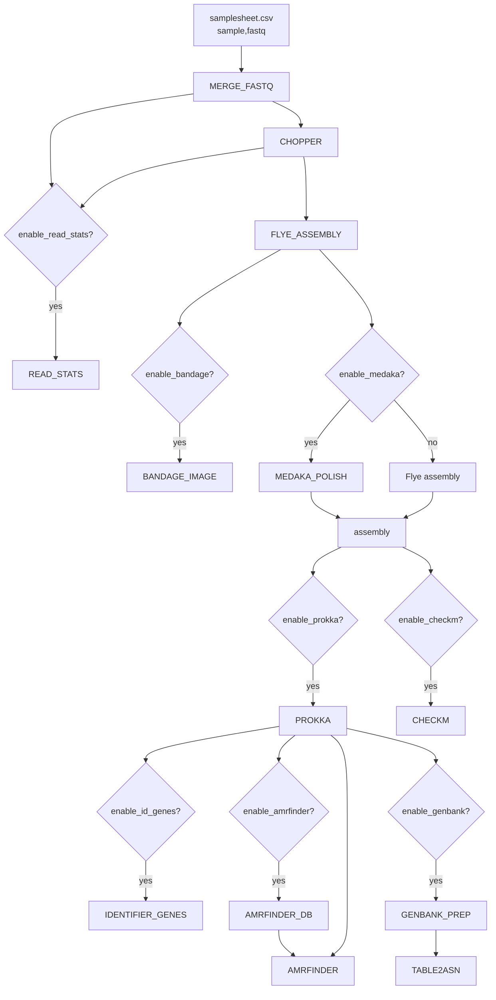

# ulana-nf

A Nextflow (DSL2) port of [ulana-ht](https://github.com/ehill-iolani/ulana-ht):
bacterial whole-genome assembly and downstream characterization from Oxford
Nanopore long reads. Flye assembly, optional Medaka polishing, Prokka
annotation, CheckM QC, marker-gene extraction, and AMRFinderPlus AMR
detection (the same steps and feature toggles as the Snakemake/RShiny original).

## What it does

1. `MERGE_FASTQ` -- merge multi-part fastq(.gz) files per sample
2. `CHOPPER` -- quality + length filtering
   - `READ_STATS` (side branch, `--enable_read_stats`, on by default) -- read length and mean Q-score before vs. after filtering
3. `FLYE_ASSEMBLY` -- assembly
4. `BANDAGE_IMAGE` -- render a PNG of the Flye assembly graph (optional, default on)
5. `MEDAKA_POLISH` -- polish (optional, default on)
6. `PROKKA` -- annotate (optional, default on)
7. `CHECKM` -- QC (optional, default on)
8. `IDENTIFIER_GENES` -- extract 16S rRNA / dnaA / rpoB from Prokka output (optional, default on; requires Prokka)
9. `AMRFINDER_DB` + `AMRFINDER` -- AMR detection (optional, default on; requires Prokka)
10. `GENBANK_PREP` + `TABLE2ASN` -- GenBank submission files (optional, default off; requires Prokka and the samplesheet's organism/locus_tag columns, see [GenBank submission](#genbank-submission))



## Requirements

- [Nextflow](https://www.nextflow.io/) >= 23.10.0
- One of Docker, Singularity, or Conda (every process is containerized;
  pick a profile below)

## Quickstart

```bash
nextflow run main.nf --input samplesheet.csv -profile docker
```

`samplesheet.csv` is a two-column CSV:

```csv
sample,fastq
12-45-SW-A-1,data/12-45-SW-A-1_ONT.fastq.gz
18-T-HS-3-S-2-30-S,data/18-T-HS-3-S-2-30-S_ONT.fastq.gz
```

With `--enable_genbank` it also needs `organism` and `locus_tag` columns
(`strain` is optional, except for a `Genus sp.` organism):

```csv
sample,fastq,organism,strain,locus_tag
25-KEA-6,data/25-KEA-6_combined.fastq.gz,Pseudomonas sp.,KEA-6,KEAT
```

A damaged `.fastq.gz` part stops the run at `MERGE_FASTQ` with the sample
and file named, rather than silently losing every read after it.

## Parameters

See `nextflow_schema.json` for the full list with defaults and validation, or
run `nextflow run main.nf --help`. Key ones:

| Parameter | Default | Description |
|---|---|---|
| `--input` | *(required)* | Samplesheet CSV (`sample,fastq`) |
| `--outdir` | `results` | Output directory |
| `--chopper_q` / `--chopper_minlength` | `10` / `1000` | chopper quality/length filtering |
| `--enable_read_stats` | `true` | Read length/Q-score summary before vs. after filtering |
| `--flye_mode` | `--nano-hq` | Flye read-type flag |
| `--enable_bandage` / `--bandage_height` | `true` / `1000` | Render a PNG of the Flye assembly graph |
| `--enable_medaka` / `--medaka_model` | `true` / `r1041_e82_400bps_hac_v5.0.0` | Medaka polishing |
| `--enable_prokka` | `true` | Prokka annotation |
| `--enable_checkm` | `true` | CheckM QC |
| `--enable_id_genes` | `true` | Marker gene extraction (requires `--enable_prokka`) |
| `--enable_amrfinder` | `true` | AMRFinderPlus AMR detection (requires `--enable_prokka`); DB is downloaded fresh every run |
| `--enable_genbank` | `false` | GenBank submission files (requires `--enable_prokka` and the samplesheet's `organism` + `locus_tag` columns) |
| `--genbank_template` | *(none)* | NCBI submitter template (`.sbt`) to build into the `.sqn` |
| `--container_registry` / `--dockerhub_registry` | `quay.io` / `docker.io` | Registries the tool images are pulled from. The `google_batch` profile points both at the project's Artifact Registry mirror (see [Container mirror](#container-mirror)); pass the defaults to pull from upstream |

## Output layout

```
results/
  {sample}/
    reads/            merged + filtered fastq
    assembly/flye/    assembly.fasta, assembly_info.txt, assembly_graph.gfa, assembly_graph.png (only if --enable_bandage)
    polish/medaka/    polished_consensus.fasta (only if --enable_medaka)
    annotation/prokka/  .tsv .faa .ffn .gff (only if --enable_prokka)
    qc/checkm/        summary.tsv (only if --enable_checkm)
    id_genes/         16S_rRNA.fasta, dnaA.fasta, rpoB.fasta, one record per gene copy (only if --enable_id_genes)
    amr/              amrfinder_pro_results.tsv, amrfinder_pro.fasta (only if --enable_amrfinder)
    genbank/          {sample}.sqn .fsa .tbl .cmt .gbf .val .stats .dr, submission_info.txt (only if --enable_genbank)
  read_qc/            read_qc_summary.html, read_stats.tsv, read_length_qscore_hist.tsv (only if --enable_read_stats)
  db/amrfinder_db/    AMRFinderPlus database for this run
  pipeline_info/       Nextflow timeline/report/trace
```

## Repo structure

```
main.nf                     entry point, samplesheet parsing, --help
workflows/ulana_wgs.nf       subworkflow chaining all steps
modules/*.nf                 one process per tool, one container each
bin/read_stats.py            read length/Q-score summary (stdlib only; also runs stand-alone)
bin/pick_genes.sh            pulls the identifier genes out of Prokka's .ffn, one record per copy
bin/genbank_prep.py          Prokka .fsa/.tbl -> GenBank-ready files (stdlib only; also runs stand-alone)
nextflow.config               param defaults, profiles, resource labels
nextflow_schema.json          JSON Schema describing every --param (for UIs/validation tooling)
conf/test.config              -profile test overrides (small synthetic dataset)
tests/data/                   small synthetic dataset used by -profile test
scripts/mirror_images.sh      copies the pipeline's container images into our Artifact Registry (see Container mirror)
.github/workflows/ci.yml      runs -profile test on push/PR
```

## GenBank submission

`--enable_genbank` turns the Prokka annotation into the files for a GenBank
genome submission. The fiddly part of submitting is getting NCBI's validator
to accept the annotation, so the pipeline does that and runs NCBI's own checks:

1. Register a BioProject and BioSample at NCBI first. The locus tag prefix
   comes from there and goes in the samplesheet's `locus_tag` column, along
   with `organism` (and `strain`). Prokka then names genes `KEAT_00001`, ...
2. Optionally make a submitter template (`.sbt`) with
   [NCBI's form](https://submit.ncbi.nlm.nih.gov/genbank/template/submission/)
   and pass it with `--genbank_template`. Without one the `.sqn` has no
   submitter or citation, and the validation report lists that as its two errors.
3. `GENBANK_PREP` (`bin/genbank_prep.py`) fixes what the validator rejects in
   Prokka's output:
   - adds a `gene` feature per CDS/RNA and a `protein_id` per CDS;
   - renames "putative protein" and the like to "hypothetical protein";
   - removes EC numbers and gene names from hypothetical proteins;
   - removes Prokka's `_1`/`_2` gene-name suffixes;
   - drops barrnap's partial rRNA fragments and contigs under 200 bp;
   - puts the strain into a `Genus sp.` organism name;
   - marks contigs Flye closed as circular;
   - writes NCBI's Genome-Assembly-Data comment (assembly method, coverage,
     sequencing technology).
   Prokka's own outputs in `annotation/prokka/` are unchanged.
4. `TABLE2ASN` builds `{sample}.sqn` (the file to upload) and
   `{sample}.gbf` (the GenBank record, to read before sending), and runs
   NCBI's validation (`.val`, counts in `.stats`) and discrepancy report (`.dr`).

`submission_info.txt` lists what was changed and the values NCBI's Genome
Submission Portal asks for. Fix every `ERROR` in the `.val` and every `FATAL`
in the `.dr` before submitting. On a real 5.5 Mb Pseudomonas assembly with a
template, the result had no errors or FATALs, only warnings NCBI accepts
(UniProt product names ending in a bracket, a circular contig not flagged complete).

## Container mirror

On Google Batch every task starts on a fresh VM and pulls its image, so one
timed-out pull from quay.io or Docker Hub can end a long run. The
`google_batch` profile therefore pulls from our own Artifact Registry repo
(`us-central1-docker.pkg.dev/iscc-400300/containers`), which keeps each
image's upstream path (`biocontainers/flye:...`, `ontresearch/medaka:...`,
`library/ubuntu:...`) so only the registry host differs. The repo is shared
with the other pipelines; images they also use (same tags) are already there.

`scripts/mirror_images.sh` fills it. It reads the image list from the
pipeline's own `container` directives, so it can't drift:

```bash
gcloud auth configure-docker us-central1-docker.pkg.dev   # once, for pushing
scripts/mirror_images.sh --check     # read-only: is every image there, same digest as upstream?
scripts/mirror_images.sh             # copy whatever is missing
```

Run it again whenever an image tag is added or changed, and before releasing
(`--check` exits 1 if anything is missing). Every `container` must go through
`${params.container_registry}` or `${params.dockerhub_registry}`; the script
refuses to run if one doesn't, since it would silently bypass the mirror.

## Testing

```bash
nextflow run main.nf -profile test,docker
```

Runs against two synthetic samples checked into `tests/data/` (see
`tests/data/generate_synthetic_reads.py` for how they were generated).
CheckM and AMRFinder are off in this profile since both need multi-GB
reference databases fetched at runtime, impractical for CI -- Prokka and
Medaka stay on since neither needs an external download.

## Relationship to ulana-ht

This is a from-scratch DSL2 reimplementation, not a Snakemake wrapper.
Behavior differs from the original in one place worth flagging:
`AMRFINDER_DB` explicitly downloads the database into its own published
directory and passes it to `AMRFINDER` via `-d`, rather than relying on
`amrfinder --force_update`'s implicit default install path -- the Snakemake
version could rely on a single shared conda env's filesystem across rules,
but each Nextflow process gets a fresh container, so the db has to be an
explicit input/output like any other file.

## Citation

Based on the ULANA pipeline concept (Unicellular Long-read Assembly aNd
Annotation). See the [ULANA paper](https://www.liebertpub.com/doi/10.1089/ast.2023.0072):

Prescott, R. D., Chan, Y. L., Tong, E. J., Bunn, F., Onouye, C. T., Handel, C., Lo, C.-C., Davenport, K., Johnson, S., Flynn, M., Saito, J. A., Lee, H., Wong, K., Lawson, B. N., Hiura, K., Sager, K., Sadones, M., Hill, E. C., Esibill, D., … Donachie, S. P. (2023a). Bridging Place-based astrobiology education with genomics, including descriptions of three novel bacterial species isolated from Mars analog sites of cultural relevance. Astrobiology, 23(12), 1348–1367. https://doi.org/10.1089/ast.2023.0072
