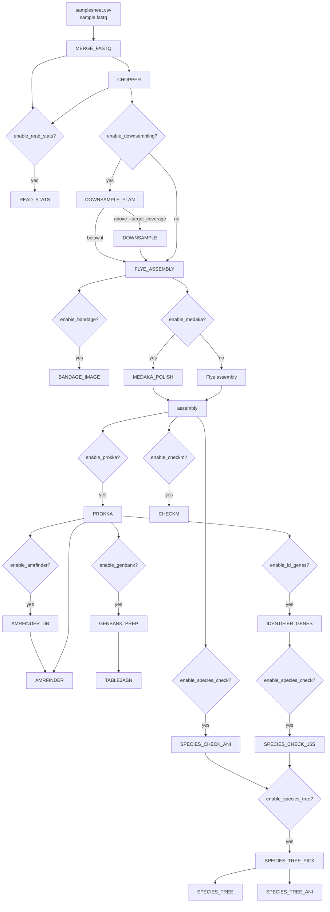

# ulana-nf

A Nextflow (DSL2) port of [ulana-ht](https://github.com/ehill-iolani/ulana-ht):
bacterial whole-genome assembly and downstream characterization from Oxford
Nanopore long reads. Flye assembly, optional Medaka polishing, Prokka
annotation, CheckM QC, marker-gene extraction, and AMRFinderPlus AMR
detection (the same steps and feature toggles as the Snakemake/RShiny original).

## What it does

1. `MERGE_FASTQ` -- merge multi-part fastq(.gz) files per sample
2. `CHOPPER` -- quality + length filtering
   - `READ_STATS` (side branch, `--enable_read_stats`, on by default) -- read length and mean Q-score before vs. after filtering
   - `DOWNSAMPLE_PLAN` + `DOWNSAMPLE` -- cap very deep samples at `--target_coverage` before assembly (on by default, see [Downsampling](#downsampling))
3. `FLYE_ASSEMBLY` -- assembly
4. `BANDAGE_IMAGE` -- render a PNG of the Flye assembly graph (optional, default on)
5. `MEDAKA_POLISH` -- polish (optional, default on)
6. `PROKKA` -- annotate (optional, default on)
7. `CHECKM` -- QC (optional, default on)
8. `IDENTIFIER_GENES` -- extract 16S rRNA / dnaA / rpoB from Prokka output (optional, default on; requires Prokka)
9. `AMRFINDER_DB` + `AMRFINDER` -- AMR detection (optional, default on; requires Prokka)
10. `GENBANK_PREP` + `TABLE2ASN` -- GenBank submission files (optional, default off; requires Prokka and the samplesheet's organism/locus_tag columns, see [GenBank submission](#genbank-submission))
11. `SPECIES_CHECK_ANI` + `SPECIES_CHECK_16S` -- closest NCBI type strains by genome ANI (skani) and 16S (BLAST) (optional, default on; needs a `--species_db` snapshot, see [Species check](#species-check))
12. `SPECIES_TREE_PICK` + `SPECIES_TREE` + `SPECIES_TREE_ANI` -- marker-gene tree of the assembly with its closest type strains (GToTree + IQ-TREE) and their pairwise ANI (optional, default on; needs the species check, see [Species tree](#species-tree))



## Requirements

- [Nextflow](https://www.nextflow.io/) >= 23.10.0
- One of Docker, Singularity, or Conda (every process is containerized;
  pick a profile below)

## Quickstart

```bash
nextflow run main.nf --input samplesheet.csv -profile docker
```

`samplesheet.csv` is a two-column CSV:

```csv
sample,fastq
12-45-SW-A-1,data/12-45-SW-A-1_ONT.fastq.gz
18-T-HS-3-S-2-30-S,data/18-T-HS-3-S-2-30-S_ONT.fastq.gz
```

With `--enable_genbank` it also needs `organism` and `locus_tag` columns
(`strain` is optional, except for a `Genus sp.` organism):

```csv
sample,fastq,organism,strain,locus_tag
25-KEA-6,data/25-KEA-6_combined.fastq.gz,Mycobacteroides sp.,KEA-6,KEAT
```

Each row needs its own `sample` name (compared ignoring case): two rows with
the same name stop the run at launch.

A damaged `.fastq.gz` part stops the run at `MERGE_FASTQ` with the sample
and file named, rather than silently losing every read after it.

## Parameters

See `nextflow_schema.json` for the full list with defaults and validation, or
run `nextflow run main.nf --help`. Key ones:

| Parameter | Default | Description |
|---|---|---|
| `--input` | *(required)* | Samplesheet CSV (`sample,fastq`) |
| `--outdir` | `results` | Output directory |
| `--chopper_q` / `--chopper_minlength` | `10` / `1000` | chopper quality/length filtering |
| `--enable_read_stats` | `true` | Read length/Q-score summary before vs. after filtering |
| `--enable_downsampling` / `--target_coverage` | `true` / `150` | Subsample samples deeper than this to it before assembly (Rasusa) |
| `--genome_size` | *(blank: LRGE estimates it per sample)* | Genome size the target coverage is worked out from, e.g. `92kb`, `5.5mb` |
| `--flye_mode` | `--nano-hq` | Flye read-type flag |
| `--enable_bandage` / `--bandage_height` | `true` / `1000` | Render a PNG of the Flye assembly graph |
| `--enable_medaka` / `--medaka_model` | `true` / `r1041_e82_400bps_hac_v5.0.0` | Medaka polishing |
| `--enable_prokka` | `true` | Prokka annotation |
| `--enable_checkm` | `true` | CheckM QC |
| `--enable_id_genes` | `true` | Marker gene extraction (requires `--enable_prokka`) |
| `--enable_amrfinder` | `true` | AMRFinderPlus AMR detection (requires `--enable_prokka`); DB is downloaded fresh every run |
| `--enable_genbank` | `false` | GenBank submission files (requires `--enable_prokka` and the samplesheet's `organism` + `locus_tag` columns) |
| `--genbank_template` | *(none)* | NCBI submitter template (`.sbt`) to build into the `.sqn` |
| `--enable_species_check` | `true` | Closest NCBI type strains by genome ANI and 16S (skipped with a warning without `--species_db`) |
| `--species_db` | *(none; the `google_batch` profile sets it)* | Type-strain snapshot folder from `scripts/build_typestrain_db.py`, local or `gs://` |
| `--enable_species_tree` | `true` | Marker-gene tree with the closest type strains (needs the species check and a snapshot with `lineage.tsv` + `gtotree_hmms/`) |
| `--container_registry` / `--dockerhub_registry` | `quay.io` / `docker.io` | Registries the tool images are pulled from. The `google_batch` profile points both at the project's Artifact Registry mirror (see [Container mirror](#container-mirror)); pass the defaults to pull from upstream |

## Output layout

```
results/
  {sample}/
    reads/            merged + filtered fastq, {sample}.downsampling.tsv (only if --enable_downsampling)
    assembly/flye/    assembly.fasta, assembly_info.txt, assembly_graph.gfa, assembly_graph.png (only if --enable_bandage)
    polish/medaka/    polished_consensus.fasta (only if --enable_medaka)
    annotation/prokka/  .tsv .faa .ffn .gff (only if --enable_prokka)
    qc/checkm/        summary.tsv (only if --enable_checkm)
    id_genes/         16S_rRNA.fasta, dnaA.fasta, rpoB.fasta, one record per gene copy (only if --enable_id_genes)
    amr/              amrfinder_pro_results.tsv, amrfinder_pro.fasta (only if --enable_amrfinder)
    genbank/          {sample}.sqn .fsa .tbl .cmt .gbf .val .stats .dr, submission_info.txt (only if --enable_genbank)
    species_check/    genome_hits.tsv, 16S_hits.tsv, typestrain_db.json (only if --enable_species_check with a --species_db)
      tree/           neighbours.tsv, tree.nwk, tree_report.txt, ani.tsv, tree_info.json (only if --enable_species_tree)
  read_qc/            read_qc_summary.html, read_stats.tsv, read_length_qscore_hist.tsv (only if --enable_read_stats)
  db/amrfinder_db/    AMRFinderPlus database for this run
  pipeline_info/       Nextflow timeline/report/trace
```

## Repo structure

```
main.nf                     entry point, samplesheet parsing, --help
workflows/ulana_wgs.nf       subworkflow chaining all steps
modules/*.nf                 one process per tool, one container each
bin/read_stats.py            read length/Q-score summary (stdlib only; also runs stand-alone)
bin/pick_genes.sh            pulls the identifier genes out of Prokka's .ffn, one record per copy
bin/genbank_prep.py          Prokka .fsa/.tbl -> GenBank-ready files (stdlib only; also runs stand-alone)
bin/species_hits.sh          skani hits + typestrains.tsv -> species_check/genome_hits.tsv
bin/sixteen_s_hits.sh        BLASTs the full-length 16S copies -> species_check/16S_hits.tsv
bin/species_tree_pick.py     picks the species tree's type-strain neighbours and marker set (stdlib only)
bin/species_tree.py          GToTree + IQ-TREE -> species_check/tree/tree.nwk, tree_info.json
bin/species_tree_ani.sh      skani triangle over the same genomes -> species_check/tree/ani.tsv
nextflow.config               param defaults, profiles, resource labels
nextflow_schema.json          JSON Schema describing every --param (for UIs/validation tooling)
conf/test.config              -profile test overrides (small synthetic dataset)
tests/data/                   small synthetic dataset used by -profile test
scripts/mirror_images.sh      copies the pipeline's container images into our Artifact Registry (see Container mirror)
scripts/build_typestrain_db.py  builds the type-strain reference set (NCBI type genomes, skani sketches, 16S db) for the species check; run once per snapshot
scripts/build_typestrain_lineage.py  adds lineage.tsv + gtotree_hmms/ to a snapshot (NCBI lineage + GToTree marker set per taxid, and the sets themselves)
.github/workflows/ci.yml      runs -profile test -stub-run on push/PR
```

## Downsampling

Flye fails on very deep data: a ~91 kb phage sequenced to ~5,000x stopped
with "No disjointigs were assembled", while a 1/20 subsample of the same
reads assembled into one contig. So before assembly each sample's filtered
reads are capped at `--target_coverage` (default 150x):

1. `DOWNSAMPLE_PLAN` counts the sample's bases and takes the genome size from
   `--genome_size`, or, left blank, estimates it from the reads with
   [LRGE](https://github.com/mbhall88/lrge). LRGE tends to guess high (a
   5.5 Mb Mycobacteroides chelonae genome came out at 7.9 Mb, ~91 kb phages
   at 82-109 kb), which errs towards keeping more reads, not fewer.
2. A sample with more than `target_coverage x genome size` bases goes to
   `DOWNSAMPLE`, where [Rasusa](https://github.com/mbhall88/rasusa) keeps a
   random subset of about that many bases (seeded, so a rerun picks the same
   reads). Random rather than best-first, so small plasmids keep their share
   of the reads.
3. Any other sample (including one whose genome size couldn't be estimated)
   keeps every filtered read, as before this step existed.

Flye and Medaka both use the subsampled reads. Flye's `assembly_info.txt`
coverage, and so the GenBank comment's "Genome Coverage", is then the depth
of the reads used, about 150x. `reads/{sample}.downsampling.tsv` records
the decision:

| Column | Meaning |
|---|---|
| `read_bases`, `read_coverage` | bases after chopper, and that depth |
| `genome_size`, `genome_size_source` | bp, and `given` / `estimated` / `unknown` |
| `target_coverage` | `--target_coverage` |
| `reads_used` | `subsample` or `all` |
| `assembly_bases`, `assembly_coverage` | what went to Flye (the target, for a subsample) |

Set `--genome_size` when every sample in the run is the same organism;
leave it blank for a run mixing organisms. `--enable_downsampling false`
assembles every read regardless.

## Species check

Compares each assembly with every bacterial type-strain genome in NCBI
RefSeq (one per species or subspecies, about 21,000) to show how close it
is to the nearest named species, in the spirit of
[TYGS](https://tygs.dsmz.de/).

- `SPECIES_CHECK_ANI`: [skani](https://github.com/bluenote-1577/skani)
  ANI and aligned fractions against the type-strain genomes, top 20 hits.
- `SPECIES_CHECK_16S`: each 16S copy of 1,200 bp or more (from
  `IDENTIFIER_GENES`) BLASTed against NCBI's `16S_ribosomal_RNA` type-strain
  database, top 10 hits per copy (the search keeps 100; the rest feed the
  species tree's neighbour pick). Supporting evidence only: 16S often can't
  tell close species apart.

The pipeline writes the hits and no verdict. The platform's results page
reads them as: ANI >= 96% (with >= 50% of the assembly aligned) = same
species; 95-96% = borderline; 85-95% = possible new species; below that, or
no hit, = no close type strain; and nothing when CheckM puts the genome
under 90% complete or over 5% contamination. A "possible new species" is a
lead, not a description: confirm with dDDH (TYGS) before naming anything.
These cutoffs came from a leave-one-out test over 226 type genomes (each
held out of its own species), kept with the snapshot.

`{sample}/species_check/`:

| File | Contents |
|---|---|
| `genome_hits.tsv` | `accession`, `name`, `species`, `subspecies`, `strain`, `taxid`, `species_taxid`, `ani`, `af_query` (% of this assembly aligned), `af_ref`, `assembly_level`, `relation_to_type_material`, `genome_size`; best ANI first, header only if no type strain is within ~80% |
| `16S_hits.tsv` | `copy`, `copy_length`, `accession`, `taxid`, `organism`, `identity`, `align_length`, `query_cover`, `bitscore`, `title`; header only with no full-length copy |
| `typestrain_db.json` | the snapshot searched (its `build_info.json`) |

**The type-strain snapshot** (`--species_db`) is built once with
`scripts/build_typestrain_db.py` (see its header; about 51 GB, of which a
run reads the 11 GB skani `sketch/`, `typestrains.tsv`, `build_info.json`
and the 16S BLAST files). `scripts/build_typestrain_lineage.py` adds
`lineage.tsv` (current names, lineage and GToTree marker set for every taxid
in `typestrains.tsv` and the 16S db) and `gtotree_hmms/` (the marker sets,
~160 MB) for the species tree, without a rebuild. The `google_batch` profile points at
`gs://nextflow-jobs/ulana/db_cache/typestrains/2026-11`. A new snapshot is a
new dated folder. Without a `--species_db` the step is skipped with a
warning, so local runs work without the download.

## Species tree

Places the assembly among its closest named relatives on a marker-gene
protein tree with support values, the tree TYGS draws beside its dDDH table.
The species check says how close; the tree shows where.

- `SPECIES_TREE_PICK` picks up to 10 type-strain genomes from the snapshot:
  the species check's genome hits first, best ANI first, one genome per
  species, except the closest species keeps all its type strains (so a split
  inside it, such as between subspecies, shows); then, to fill up, the 16S
  hits (query cover >= 90, best identity first) mapped to a type genome of the
  same species through `lineage.tsv`, taking only species that share the
  closest neighbour's most specific marker set (so an added relative never
  pushes the tree onto a broader set with fewer genes) unless that leaves
  fewer than 3. With no genome hit at all (a possible new genus) every
  neighbour comes from 16S. The marker set is the most
  specific GToTree set all of them share (`lineage.tsv`; e.g.
  Gammaproteobacteria, then Proteobacteria, then Bacteria). Fewer than 3
  neighbours: no tree.
- `SPECIES_TREE`: [GToTree](https://github.com/AstrobioMike/GToTree) finds
  the set's single-copy marker genes in each genome and builds one
  concatenated protein alignment (a genome with under half the markers is
  dropped); [IQ-TREE](https://iqtree.github.io/) builds a maximum-likelihood
  tree with 1,000 ultrafast bootstraps (`-bnni`), the model chosen by BIC
  from LG/WAG/JTT/Q.pfam x (+F) x (G4/R4).
- `SPECIES_TREE_ANI`: skani ANI between every pair of the same genomes, for
  an ANI view and 95% species groups. Pairs under ~80% are missing.

Hand tests (2026-11-10, leave-one-out cases from the snapshot's validation
set): the model choice never changed a tree's shape, only support at weak
forks; the lineage marker set did change shapes compared with the general
Bacteria set; and for a held-out genus the tree found the nearest relative
by protein identity where the 16S order didn't.

`{sample}/species_check/tree/`:

| File | Contents |
|---|---|
| `neighbours.tsv` | `label` (`query` = this assembly, else the accession), `accession`, `name`, `species`, `species_taxid`, `genus`, `family`, `source` (`skani` / `16S`), `ani`, `af_query`, `identity_16S`, `query_cover_16S` |
| `tree.nwk` | the tree, leaves labelled as in `neighbours.tsv`, UFBoot (0-100) at each fork; unrooted |
| `tree_report.txt` | IQ-TREE's report: model, likelihood, alignment |
| `ani.tsv` | `a`, `b`, `ani`, `af_a`, `af_b` for every pair skani reported |
| `tree_info.json` | `status` (`built`, `no_neighbours`, `too_few_neighbours`, `too_few_marker_genes`), neighbours and their sources, `gtotree_set`, genes in the set / found in the assembly, alignment columns, informative sites, model, genomes GToTree dropped, tool versions |

Cost: GToTree and IQ-TREE run on `process_medium`; roughly 5-15 minutes per
sample, longest for a distant neighbourhood. The neighbours' genomes (~10 x
2-6 MB) are read from the snapshot's `genomes/`.

## GenBank submission

`--enable_genbank` turns the Prokka annotation into the files for a GenBank
genome submission. The fiddly part of submitting is getting NCBI's validator
to accept the annotation, so the pipeline does that and runs NCBI's own checks:

1. Register a BioProject and BioSample at NCBI first. The locus tag prefix
   comes from there and goes in the samplesheet's `locus_tag` column, along
   with `organism` (and `strain`). Prokka then names genes `KEAT_00001`, ...
2. Optionally make a submitter template (`.sbt`) with
   [NCBI's form](https://submit.ncbi.nlm.nih.gov/genbank/template/submission/)
   and pass it with `--genbank_template`. Without one the `.sqn` has no
   submitter or citation, and the validation report lists that as its two errors.
3. `GENBANK_PREP` (`bin/genbank_prep.py`) fixes what the validator rejects in
   Prokka's output:
   - adds a `gene` feature per CDS/RNA and a `protein_id` per CDS;
   - renames "putative protein" and the like to "hypothetical protein";
   - removes EC numbers and gene names from hypothetical proteins;
   - removes Prokka's `_1`/`_2` gene-name suffixes;
   - drops barrnap's partial rRNA fragments and contigs under 200 bp;
   - puts the strain into a `Genus sp.` organism name;
   - marks contigs Flye closed as circular;
   - writes NCBI's Genome-Assembly-Data comment (assembly method, coverage,
     sequencing technology).
   Prokka's own outputs in `annotation/prokka/` are unchanged.
4. `TABLE2ASN` builds `{sample}.sqn` (the file to upload) and
   `{sample}.gbf` (the GenBank record, to read before sending), and runs
   NCBI's validation (`.val`, counts in `.stats`) and discrepancy report (`.dr`).

`submission_info.txt` lists what was changed and the values NCBI's Genome
Submission Portal asks for. Fix every `ERROR` in the `.val` and every `FATAL`
in the `.dr` before submitting. On a real 5.5 Mb Mycobacteroides chelonae
assembly with a template, the result had no errors or FATALs, only warnings
NCBI accepts (UniProt product names ending in a bracket, a circular contig not
flagged complete).

## Container mirror

On Google Batch every task starts on a fresh VM and pulls its image, so one
timed-out pull from quay.io or Docker Hub can end a long run. The
`google_batch` profile therefore pulls from our own Artifact Registry repo
(`us-central1-docker.pkg.dev/iscc-400300/containers`), which keeps each
image's upstream path (`biocontainers/flye:...`, `ontresearch/medaka:...`,
`library/ubuntu:...`) so only the registry host differs. The repo is shared
with the other pipelines; images they also use (same tags) are already there.

`scripts/mirror_images.sh` fills it. It reads the image list from the
pipeline's own `container` directives, so it can't drift:

```bash
gcloud auth configure-docker us-central1-docker.pkg.dev   # once, for pushing
scripts/mirror_images.sh --check     # read-only: is every image there, same digest as upstream?
scripts/mirror_images.sh             # copy whatever is missing
```

Run it again whenever an image tag is added or changed, and before releasing
(`--check` exits 1 if anything is missing). Every `container` must go through
`${params.container_registry}` or `${params.dockerhub_registry}`; the script
refuses to run if one doesn't, since it would silently bypass the mirror.

## Testing

```bash
nextflow run main.nf -profile test,docker
```

Runs against two synthetic samples checked into `tests/data/` (see
`tests/data/generate_synthetic_reads.py` for how they were generated).
CheckM and AMRFinder are off in this profile since both need multi-GB
reference databases fetched at runtime, impractical for CI -- Prokka and
Medaka stay on since neither needs an external download.
The species check runs against `tests/data/typestrains/`, a four-genome
snapshot made by `tests/data/generate_test_typestrains.py` from sample_a's
own synthetic genome and three made-up relatives (~94, 91, 87% ANI):
sample_a comes out at ~99-100% ANI with a species tree, sample_b with no hit
and no tree. The synthetic genomes have no marker genes, so GToTree can't
build a real tree from them: CI runs `-profile test -stub-run`, where
`SPECIES_TREE` writes a star tree over the real neighbours instead, and a
plain `-profile test` ends that step in `too_few_marker_genes`.

## Relationship to ulana-ht

This is a from-scratch DSL2 reimplementation, not a Snakemake wrapper.
Behavior differs from the original in one place worth flagging:
`AMRFINDER_DB` explicitly downloads the database into its own published
directory and passes it to `AMRFINDER` via `-d`, rather than relying on
`amrfinder --force_update`'s implicit default install path -- the Snakemake
version could rely on a single shared conda env's filesystem across rules,
but each Nextflow process gets a fresh container, so the db has to be an
explicit input/output like any other file.

## Citation

Based on the ULANA pipeline concept (Unicellular Long-read Assembly aNd
Annotation). See the [ULANA paper](https://www.liebertpub.com/doi/10.1089/ast.2023.0072):

Prescott, R. D., Chan, Y. L., Tong, E. J., Bunn, F., Onouye, C. T., Handel, C., Lo, C.-C., Davenport, K., Johnson, S., Flynn, M., Saito, J. A., Lee, H., Wong, K., Lawson, B. N., Hiura, K., Sager, K., Sadones, M., Hill, E. C., Esibill, D., … Donachie, S. P. (2023a). Bridging Place-based astrobiology education with genomics, including descriptions of three novel bacterial species isolated from Mars analog sites of cultural relevance. Astrobiology, 23(12), 1348–1367. https://doi.org/10.1089/ast.2023.0072
